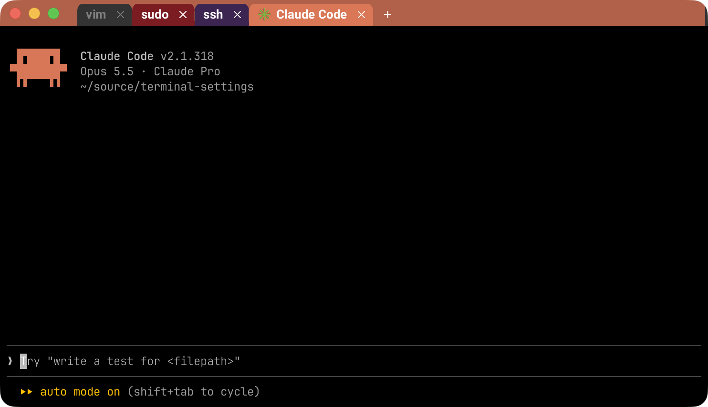
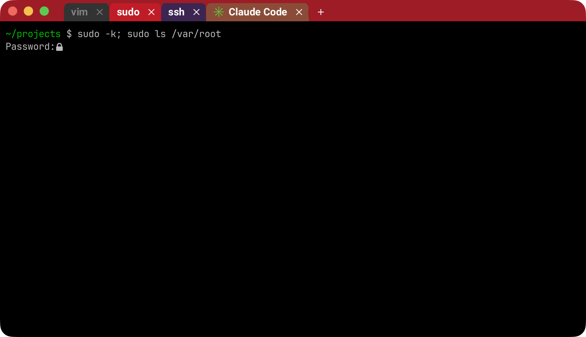
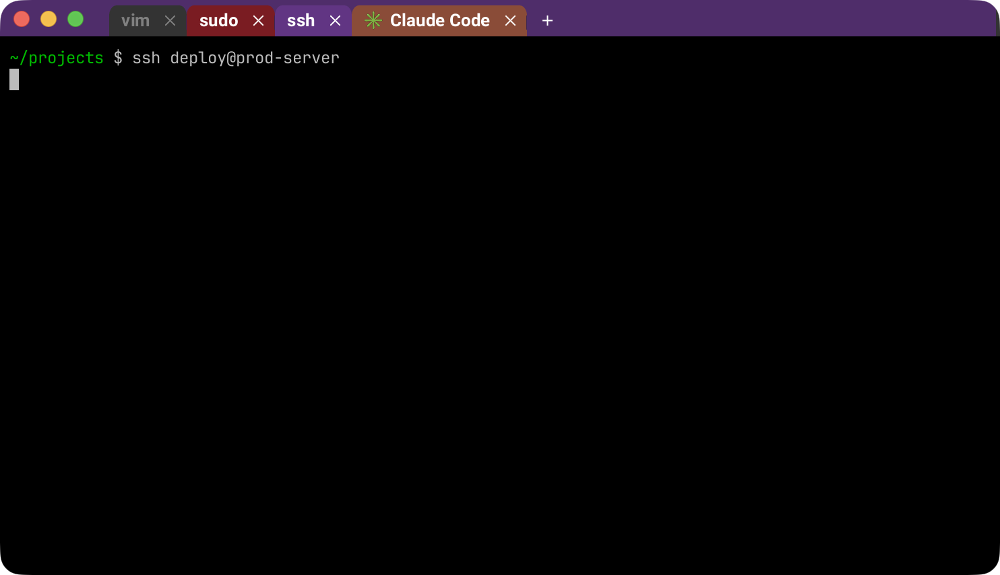

# Process-tinted WezTerm

A [WezTerm](https://wezterm.org) config that colors each tab by what is running in it, Ptyxis-style, so you always notice when you're root, on a remote machine, or in Claude Code. It also makes Ctrl+C and Ctrl+V behave the way you'd expect.



| sudo | ssh |
|---|---|
|  |  |

## Features

| Running in the tab | Color |
|---|---|
| `sudo`, `su`, `doas`, `run0`, `pkexec` | red |
| `ssh`, `mosh`, `et`, `telnet`, `scp`, `sftp` | purple |
| `claude` (Claude Code) | orange |

- Each tab is colored by its own foreground process. The header bar takes on a slightly darker shade of the active tab's color, so the active tab still stands out.
- Tab titles follow the running program (`zsh` → `vim` → `zsh`) without waiting for a mouse hover.
- **Ctrl+C** copies when text is selected, otherwise it sends ^C. **Ctrl+V** pastes. Ctrl+Shift+C/V still work.
- **Ctrl+Shift+E** (Cmd+Shift+E on macOS) sets the whole tab title, and programs can't overwrite it. An empty title switches back to the automatic one.

## Install

Install WezTerm (macOS: `brew install --cask wezterm`; Linux: the native package from [wezterm.org](https://wezterm.org/install/linux.html)), then:

```sh
mkdir -p ~/.config/wezterm
ln -sf "$PWD/wezterm.lua" ~/.config/wezterm/wezterm.lua
```

WezTerm reloads the config automatically when the file changes.

## Customize

Colors, process lists and keys are at the top of `wezterm.lua` (`KIND_COLORS`, `SUPERUSER`, `REMOTE`, `config.keys`).

## Limitations

- Only local processes are detected: Claude Code running *over ssh* shows as remote (purple).
- Colors and titles are updated by polling every 0.5 s, so changes can take up to half a second to appear.
- The Linux Flatpak build runs sandboxed and may not see host processes. Use the native package.
